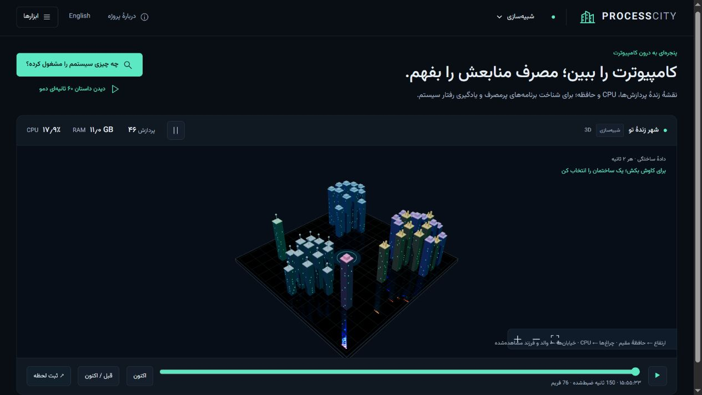

# Process City

**Your computer, a living city.**

An interactive Windows process observatory. Every process becomes a building, working-set memory shapes the skyline, CPU activity lights the windows, and parent-child relationships become streets.

[Try the simulation](https://process-city-hhhkarimi.vercel.app) · [دموی فارسی](https://process-city-hhhkarimi.vercel.app/?lang=fa) · [راهنمای فارسی](README.fa.md)



## Two modes, honestly labeled

| Mode            | Data source                                     | Where it runs                                                    |
| --------------- | ----------------------------------------------- | ---------------------------------------------------------------- |
| Demo simulation | Synthetic, deterministic Windows-like processes | Any modern browser, including the hosted demo                    |
| Live Windows    | Windows process and system counters             | Your own Windows machine through a loopback-only local collector |

The hosted site **cannot read your computer**. The demo buttons do not allocate real CPU or memory. Real process data is never uploaded to the demo host.

## Run on Windows

Requirements: Windows 10/11, Windows PowerShell 5.1 or newer, Node.js 22.18+ or 24+, and npm. No administrator access is requested. Some protected processes do not expose CPU counters; these show `—` rather than invented zero readings.

```powershell
npm ci
npm run build
npm start
```

Open **http://127.0.0.1:4317** and choose **Live Windows**. The local server starts its own hidden PowerShell collector. Closing it also stops that collector.

### Restricted environments: two-terminal mode

If child-process launch is blocked, keep the collector and server in separate terminals. Both commands run locally; no policy or permission changes are needed.

Terminal 1, from this project folder:

```powershell
New-Item -ItemType Directory -Path work -Force | Out-Null
$cityFile = Join-Path (Get-Location) 'work\live.json'
.\server\collect.ps1 -OutputFile $cityFile
```

Terminal 2, from the same folder:

```powershell
$cityFile = Join-Path (Get-Location) 'work\live.json'
npm start -- --collector-file $cityFile
```

Open the same loopback URL and select **Live Windows**. Stop both terminals with Ctrl+C when finished. The collector file contains local process names and metrics; `work/` is ignored by Git.

For the browser-only demo or UI development:

```sh
npm ci
npm run dev
```

The development server opens at `http://127.0.0.1:5174`. Its `/api` proxy connects only to the local server on port 4317. Demo-only use also works on macOS/Linux; the real collector is Windows-only.

## Explore the city

- Click a building or a process row to inspect CPU, working set, private memory history, parent and children.
- Search by process name or PID. Sort by memory, CPU or name. Filter processes with sustained private-memory growth.
- Pan by dragging; use +/− to zoom and Fit to reset. With the canvas focused, arrows pan, +/− zoom and 0 resets the camera.
- Toggle process labels and parent-child streets. The searchable process list includes all collected processes; the map is limited to 110 buildings for predictable rendering cost.
- Pause freezes sampling and animation; resume reads the current counters again.
- Capture city downloads a PNG with an explicit simulation/live watermark. Export current snapshot is available in **How it works**.
- Persian and English UI, bundled Vazirmatn font, reduced-motion support and an accessible process list alongside the visual canvas.

## Make a little chaos

In **Demo simulation**, enable **CPU surge** to load the synthetic Node district. Enable **Memory leak** to grow `memory-lab.exe` by 24 MB per update. Its building expands; a growth signal eventually raises floodwater. **Recover city** stops the scenarios and gradually releases synthetic leaked memory.

### What the water actually means

A memory-growth signal requires all of:

- at least 6 observations spanning at least 12 seconds;
- at least 16 MB and 15% increase in **private memory**;
- increases in at least 70% of intervals within the retained window.

The detector uses up to 30 samples (about one minute at the normal two-second cadence). Floodwater scales with the combined positive growth of flagged processes. **This is a visual heuristic, not proof of a leak**: caches, compilers and legitimate workloads may grow memory. Working-set size determines buildings; private bytes determine the growth heuristic.

## Themes and contributions

Four included themes: **Neon metropolis**, **Emerald forest**, **Orbital station**, **Deep aquarium**. Each changes the palette and building geometry.

Add a typed `Theme` entry to `src/themes.ts`. Geometry variants are implemented in `src/city.ts`. See [CONTRIBUTING.md](CONTRIBUTING.md) for the checks and theme contract.

## Implementation

- `server/collect.ps1`: read-only native Windows sampling via `GetProcesses`, Tool Help parent IDs, `GetSystemTimes` and `GlobalMemoryStatusEx`. No WMI/CIM dependency, command lines, file paths, usernames or environment variables are collected.
- `server/collector.ts`: bounded JSON-lines collection or external collector-file ingestion.
- `server/http.ts`: loopback-only HTTP service and static application; explicit Host and Origin validation; no cross-origin data sharing; no write or process-termination endpoints.
- `src/model.ts`: validated raw snapshot schema.
- `src/metrics.ts`: CPU deltas, process identity, memory growth, bounded histories and events.
- `src/city.ts`: dependency-free Canvas 2D isometric renderer, stable process slots, hit testing and camera controls; at most 20 animation frames per second, suspended while the page is hidden.
- `src/main.ts`: bilingual UI, collection lifecycle and explicit source states.

CPU percentages use **total machine capacity**: one saturated logical core on a four-core system is about 25%. The first reading needs a second sample. Per-process CPU may be unavailable or not sum exactly to the system CPU counter. Physical RAM usage comes from system availability; process working sets are not summed because shared pages can be counted more than once.

Process identity combines PID and creation time when available, so recycled PIDs do not inherit old histories. Parent links are rejected when the observed parent started after its child. Missing creation times limit identity confidence. Collection spans a short interval, rather than an atomic operating-system snapshot.

## Test and build

```sh
npm test
npm run build
```

The test suite covers CPU normalization, PID reuse, parent identity, memory-growth thresholds, noisy histories, bounded events, collector payload validation, simulation behavior and HTTP origin/path/method boundaries. GitHub Actions runs the same tests and build on Linux; actual collection is additionally tested on Windows.

Optional **real** bounded workloads for checking your local monitor (never launched by the UI):

```powershell
node --experimental-strip-types tools/workload.ts memory
node --experimental-strip-types tools/workload.ts cpu
```

The memory fixture retains at most 96 MB and exits after 20 seconds. The CPU fixture uses one core for 15 seconds. Observe their printed PIDs in Live Windows. These fixtures are distinct from the browser's synthetic scenario buttons.

## Deploy the demo

Import this repository into Vercel using the **Vite** preset: build `npm run build`, output `dist`, Node 24. No environment variables are required. This deploys only the simulation interface. The Windows collector remains local; Vercel is not used as a remote process-monitoring backend.

## Scope

Version 1 is a read-only Windows monitor and browser simulation, not an OS replacement, process killer or leak profiler. It has no remote-device monitoring, autostart service, installer, session replay or historical database. Snapshot exports can contain process names; export and share deliberately. No telemetry or analytics is included. The monitoring app and PowerShell collector themselves consume some resources, which are included in live readings.

## License

Application: [MIT](LICENSE). The bundled [Vazirmatn](https://github.com/rastikerdar/vazirmatn) variable font is by Saber Rastikerdar and contributors and is distributed under [SIL OFL](public/fonts/OFL-Vazirmatn.txt).
